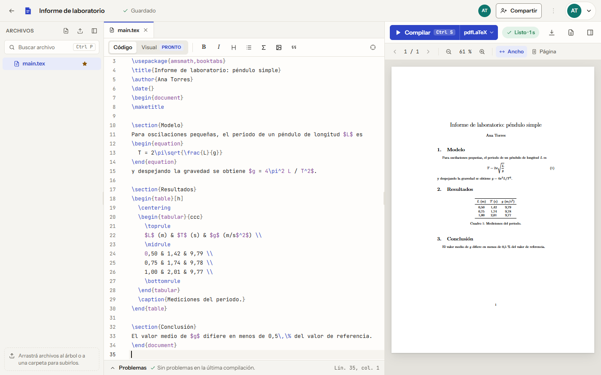
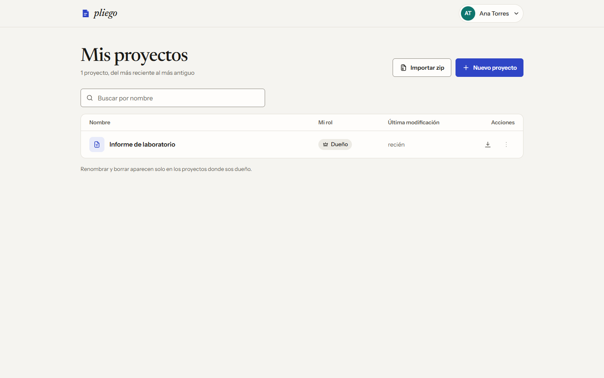
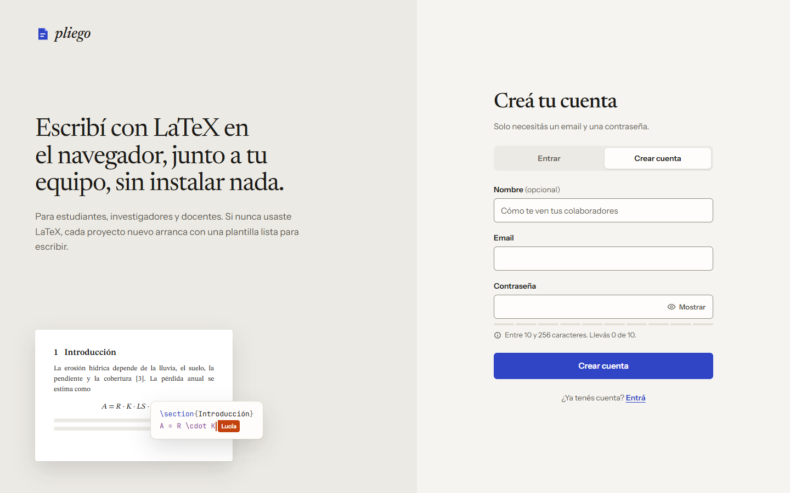
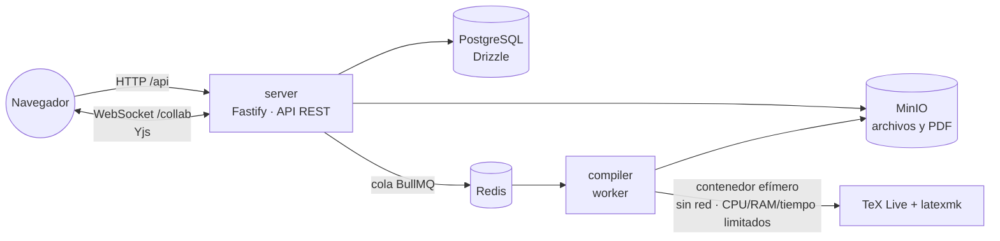

# latexweb

Editor LaTeX web, al estilo de Overleaf: proyectos con imágenes, compilación a PDF en un sandbox,
colaboración en tiempo real con cursores y SyncTeX (del código al PDF y del PDF al código).



| Mis proyectos | Entrar |
|---|---|
|  |  |

## Arquitectura


- **Colaboración:** cada documento es un Yjs compartido por Hocuspocus; los cambios y cursores viajan por
  WebSocket y se guardan en Postgres.
- **Compilación aislada:** el worker toma el trabajo de la cola, baja los archivos de MinIO, compila en un
  contenedor de TeX Live sin red y con límites, y sube el PDF, el log y el SyncTeX.
- **Permisos:** toda acción sobre un proyecto, también en el WebSocket, pasa por la misma verificación de
  acceso.

## Requisitos
- Docker (Docker Desktop o Engine 28 o posterior).
- Para desarrollar fuera de los contenedores: Node 22 (`.nvmrc`) y pnpm por corepack (`corepack enable pnpm`).

## Levantar todo con Docker
```sh
cp .env.example .env        # opcional: todo tiene valores por defecto
docker compose up -d --build
```
La primera vez tarda: construye la imagen de TeX Live completa (~5 GB). Después:

| Servicio | URL en el equipo |
|---|---|
| Web | http://127.0.0.1:55173 |
| API (Swagger en `/api/docs`) | http://127.0.0.1:53000/api |
| Consola de MinIO | http://127.0.0.1:59001 |
| Postgres / Redis | `127.0.0.1:55432` / `127.0.0.1:56379` |

Los puertos son poco comunes a propósito, para no chocar con otros proyectos. La web publica el
puerto `55173` en `0.0.0.0`; la API y la infraestructura solo se publican en `127.0.0.1`.
Para acceder por IP pública o dominio, agrégalo a `ALLOWED_HOSTS` en `.env` y recrea los servicios.
El servicio `texlive-image` solo construye la imagen de las compilaciones y termina:
es normal verlo detenido.

> El worker de compilación monta el socket de Docker (equivale a root sobre el host): este compose es
> para uso local, no para producción.

## Desarrollo con recarga en caliente
```sh
docker compose up -d postgres redis minio texlive-image
pnpm install
pnpm dev                    # server, compiler y web (Vite en http://127.0.0.1:55173)
```

## Comandos
Para descargar los cambios en una copia clonada desde GitHub:

```sh
git pull --ff-only origin main
docker compose up -d --build
```

El archivo `.env` es propio de cada servidor y no se publica en Git. Para HTTPS, configura
`ALLOWED_HOSTS` con tu dominio, `ALLOWED_ORIGINS=https://tu-dominio` y `COOKIE_SECURE=true`.
Si la carpeta del servidor se copió manualmente y no contiene `.git`, clona el repositorio en otra
carpeta y copia allí tu `.env` antes de levantar Compose. El proyecto Compose se llama `latexweb`,
por lo que conserva los volúmenes existentes; no uses `down -v` al actualizar.

Las correcciones y la configuración de HSTS de Nginx Proxy Manager están documentadas en
[`docs/revision-zap-2026-11-27.md`](docs/revision-zap-2026-11-27.md).

| Comando | Qué hace |
|---|---|
| `pnpm test` | Tests de todas las apps (con postgres, redis y minio levantados) |
| `pnpm test:compile` | Compilaciones reales con Docker y TeX Live (lentas) |
| `pnpm lint` / `pnpm typecheck` | ESLint y TypeScript |
| `pnpm db:generate` | Genera la migración después de cambiar `server/src/schema.ts` |

## Estructura
Monorepo con pnpm workspaces: las apps comparten los contratos de la API y la validación de rutas
(`shared/`), así que hay un solo lockfile y un `node_modules/` en la raíz.

```
server/     API REST (Fastify) y colaboración (Hocuspocus/Yjs), con Postgres y MinIO
compiler/   worker que compila en contenedores sin red; texlive/ es la imagen de TeX Live
web/        React + Vite: editor (CodeMirror), visor PDF (PDF.js)
shared/     tipos de la API, códigos de error y utilidades puras comunes
docs/       roadmap, backlog y specs de cada funcionalidad
```
Cada app tiene su `Dockerfile`, su `vitest.config.ts` y sus tests en `test/`. Plan y estado:
[`docs/roadmap.md`](docs/roadmap.md). Convenciones de trabajo: [`CLAUDE.md`](CLAUDE.md).


## Google e invitaciones por correo (develop)

En el `.env` del servidor configura `GOOGLE_CLIENT_ID`, `GOOGLE_CLIENT_SECRET`,
`SESSION_SECRET` (aleatorio, mínimo 32 bytes; por ejemplo `openssl rand -hex 32`),
`PUBLIC_URL=https://pliego.duckdns.org` y `COOKIE_SECURE=true`. Los secretos nunca van a Git
ni a variables `VITE_`. En Google Cloud usa un cliente OAuth de aplicación web:

- Origen autorizado: `https://pliego.duckdns.org`.
- URI de redirección autorizada exacta: `https://pliego.duckdns.org/api/auth/google/callback`.
- Configura la pantalla de consentimiento; si está en pruebas, añade los usuarios de prueba.

El callback se deriva de PUBLIC_URL; no hace falta GOOGLE_REDIRECT_URI. Mantén el dominio en
ALLOWED_HOSTS y ALLOWED_ORIGINS. No uses comodines. El navegador solo se redirige a Google;
no requiere debilitar CSP ni instalar un SDK externo. Referencia: [Google OIDC](https://developers.google.com/identity/openid-connect/openid-connect).

Para enviar invitaciones configura también:

```dotenv
SMTP_HOST=smtp.gmail.com
SMTP_PORT=587
SMTP_SSL=false
SMTP_USER=tu-cuenta@gmail.com
SMTP_FROM=tu-cuenta@gmail.com
SMTP_PASSWORD=tu-contraseña-de-aplicación
```

En Gmail usa una contraseña de aplicación permitida por tu cuenta. El puerto 587 usa STARTTLS
obligatorio; 465 requiere SMTP_SSL=true. Consulta [SMTP de Nodemailer](https://nodemailer.com/smtp).
No hay que abrir un puerto entrante de correo: es una conexión saliente al proveedor SMTP.
Sin credenciales Google no aparece su botón; sin SMTP no se permite enviar invitaciones.
La configuración parcial se rechaza al arrancar, sin imprimir los secretos.

Desde Compartir, el dueño indica correo, rol y vencimiento. El correo contiene un enlace de un solo
uso: abrirlo no añade miembros. Solo lo acepta una cuenta con ese mismo correo verificado por Google;
funciona en otro navegador después de iniciar sesión. Una cuenta local existente debe entrar primero
con su contraseña y elegir «Vincular Google» en su menú. No se fusionan cuentas solo por email.
Otra cuenta recibe 403, sin ver datos del proyecto. Las invitaciones vencidas, revocadas o aceptadas
no sirven. Los enlaces libres anteriores se identifican como tales y conservan su comportamiento;
puedes revocarlos desde Compartir. La UI crea únicamente invitaciones vinculadas al destinatario.
El envío aceptado por SMTP no garantiza entrega en bandeja de entrada: revisa spam y el proveedor.

En un checkout Git del servidor, con cambios locales guardados:

```bash
git fetch origin
git switch develop
git pull --ff-only origin develop
docker compose up -d --build server web
```

Las migraciones aditivas se aplican al iniciar el backend; conserva tus respaldos habituales. No borres
volúmenes. Si tu carpeta del servidor fue copiada sin `.git`, usa el procedimiento de clonación descrito
arriba y conserva `.env`, el nombre Compose y los volúmenes existentes. Las actualizaciones futuras
se descargan con el mismo `git pull --ff-only origin develop` y reconstrucción.

## Privacidad y aceptación

El aviso público está en `/privacidad`, con ARCM Solutions como responsable y
jona16lozada@gmail.com como contacto, según la configuración indicada para esta instancia.
Después de autenticar con Google o contraseña, `/privacidad/aceptar` exige una casilla explícita
antes de usar proyectos o aceptar invitaciones. Se puede cerrar sesión sin aceptar. También se
aplica a las cuentas y sesiones existentes: la migración no registra aceptación retroactiva.
La API de proyectos y el WebSocket comprueban el registro en el servidor.

`privacy_acceptances` conserva usuario, versión y fecha del servidor; no añade IP ni agente del
navegador. La aceptación es idempotente y persiste en nuevas sesiones. El texto y su versión están
en `shared/src/privacy.ts`: al modificarlo se debe cambiar la versión para pedir nueva aceptación.
Los registros históricos se eliminan en cascada al eliminar la cuenta. El consentimiento de Google
solo autentica; no reemplaza esta aceptación del aviso de Pliego.

El texto describe el tratamiento implementado y el canal de solicitudes. ARCM Solutions debe
completar y revisar los detalles operativos y legales que correspondan (plazos efectivos de registros
y respaldos, ubicación/proveedores, transferencias y demás información de su operación). La casilla
no acredita por sí sola cumplimiento integral de la normativa. Referencia: [SPDP, consentimiento](https://www.spdp.gob.ec/docs/proteccion-de-datos-personales/general/consentimiento/).

El logo del botón procede del [recurso oficial de Google](https://developers.google.com/static/identity/images/g-logo.png)
y se sirve localmente, sin SDK externo ni cambios que relajen CSP. Referencia: [guía de marca](https://developers.google.com/identity/branding-guidelines).

Descarga `develop` y reconstruye `server` y `web` como se indica arriba. La migración
`0005_aceptaciones_privacidad.sql` se aplica al arrancar; conserva los respaldos habituales.
